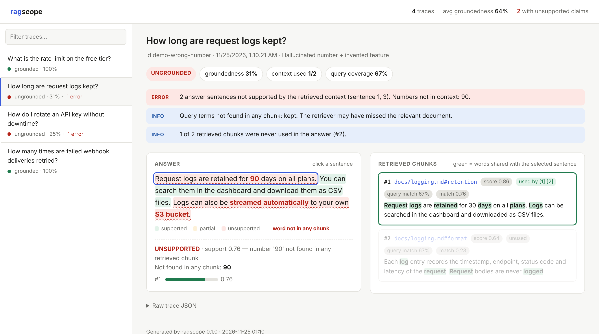

# ragscope

[](https://github.com/manish2021iitd/RagScope/actions/workflows/ci.yml)   

**See inside your RAG pipeline.** For every question, ragscope shows which chunks were retrieved and why, which of them the answer actually used, and which claims in the answer **aren't supported by any retrieved chunk**.



- **Zero dependencies.** Pure Python, works offline, no API keys, no LLM-as-judge bill.
- **Framework-agnostic.** Log plain strings or dicts, LangChain `Document`s or LlamaIndex nodes with two lines of code.
- **Explains itself.** Every flag points at the exact sentence, the exact missing word or number, and the chunk it came closest to.
- **CI-ready.** `ragscope analyze traces.jsonl --fail-on-unsupported` exits non-zero when answers start making things up.

## Quick start

```bash
pip install git+https://github.com/manish2021iitd/ragscope
ragscope demo --open          # analyse built-in example traces and open the report
```

## Instrument your pipeline

```python
from ragscope import Tracer

tracer = Tracer("traces.jsonl")

def answer(question: str) -> str:
    with tracer.trace(question) as t:
        with t.timed("retrieval"):
            docs = retriever.invoke(question)      # any retriever
        t.retrieved(docs)
        with t.timed("generation"):
            reply = llm.invoke(build_prompt(question, docs))
        t.answered(reply)
    return reply
```

Then:

```bash
ragscope analyze traces.jsonl              # terminal diagnosis
ragscope report  traces.jsonl --open       # interactive HTML report (one self-contained file)
```

`t.retrieved()` accepts:

| You pass | Example |
|---|---|
| strings | `["chunk one", "chunk two"]` |
| dicts | `{"text": ..., "id": ..., "score": ..., "source": ...}` (`page_content`/`content` also work) |
| LangChain | `Document` objects, or `(Document, score)` from `similarity_search_with_score` |
| LlamaIndex | `NodeWithScore` objects from `retriever.retrieve()` |

Already have logs? Any JSON/JSONL with `query` (or `question`/`input`), `chunks` (or `contexts`), and `answer` (or `response`/`output`) loads directly, including RAGAS-style datasets.

## What it checks

| Check | What it means |
|---|---|
| **Unsupported sentence** | No retrieved chunk contains the sentence's content. This is the hallucination signal. |
| **Number not in context** | The answer states a number (`90 days`, `$49`, `3.4 million`) that appears in no chunk. This is flagged even when every other word matches. |
| **Partial support** | Some of the sentence is in the context and some isn't. |
| **Unused context** | Chunks that were retrieved but never contributed to the answer, which wastes tokens. |
| **Off-topic chunk** | A chunk that shares no terms with the query. |
| **Duplicate chunks** | Near-identical chunks filling the context window. |
| **Retrieval gap** | Query terms that appear in no chunk, a hint that the right document was never retrieved. |
| **Rerank opportunity** | The chunk that carried the answer was ranked below #3. |

Each trace gets a verdict (`grounded`, `partially grounded`, `ungrounded`) and three metrics:

- **groundedness**: share of the answer's factual content that is supported (supported = 1, partial = 0.5)
- **context used**: retrieved chunks that contributed to the answer
- **query coverage**: query terms found anywhere in the retrieved context

### Terminal output

```
━━ trace demo-wrong-number · Hallucinated number + invented feature ━━━━━━━━━━━
Q: How long are request logs kept?
UNGROUNDED   groundedness 31%   context used 1/2   query coverage 67%

Answer
 ✗ [1] Request logs are retained for 90 days on all plans.
       ↳ from #1 (0.76) · not in context: 90 · number '90' not found in any retrieved chunk
 ✓ [2] You can search them in the dashboard and download them as CSV files.
       ↳ from #1 (1.00)
 ✗ [3] Logs can also be streamed automatically to your own S3 bucket.
       ↳ not in context: streamed, automatically, S3, bucket
```

## How it works

1. The answer is split into sentences. Citation markers like `[1]` and list bullets are ignored, and filler like "Hope this helps!" is marked neutral.
2. Each sentence is scored against each chunk using stemmed word overlap plus word-pair (bigram) overlap. The sentence can also be credited when its facts are spread across several chunks.
3. Every number in the answer must appear in the context, otherwise the sentence is unsupported.
4. Optional: `--embed` adds a semantic similarity score so that paraphrases count as support.

The default scorer is lexical **on purpose**. It is deterministic, fast enough to run on every commit, and every decision it makes can be explained ("these 4 words are in no chunk"). The trade-off is that a heavily paraphrased but correct answer may show as *partial*. For that case, turn on semantic matching:

```bash
pip install "ragscope[semantic] @ git+https://github.com/manish2021iitd/ragscope"
ragscope report traces.jsonl --embed                         # all-MiniLM-L6-v2
ragscope report traces.jsonl --embed BAAI/bge-small-en-v1.5  # or any sentence-transformers model
```

In Python, pass any function that maps `list[str]` to vectors:

```python
from ragscope import analyze, load_traces
results = [analyze(t, embed=my_embed_fn) for t in load_traces("traces.jsonl")]
```

Semantic matching never overrides the number check: "90 days" against a context that says "30 days" stays flagged.

## Use it in CI

Keep a set of golden questions and run them through your pipeline on every PR:

```yaml
- run: python scripts/run_golden_questions.py   # writes traces.jsonl via ragscope.Tracer
- run: ragscope analyze traces.jsonl --fail-on-unsupported --fail-under 0.8
- run: ragscope report traces.jsonl -o rag-report.html
  if: always()
- uses: actions/upload-artifact@v4
  if: always()
  with: { name: rag-report, path: rag-report.html }
```

## Try the example pipeline

`examples/toy_rag.py` is a complete RAG pipeline (BM25 retriever plus a fake LLM that sometimes embellishes) that needs no API keys:

```bash
python examples/toy_rag.py
ragscope report toy_traces.jsonl --open
```

## CLI reference

```
ragscope demo    [-o DIR] [--open]
ragscope analyze FILE... [--json] [-v] [--only-flagged]
                         [--fail-under X] [--fail-on-unsupported]
                         [--embed [MODEL]] [--supported X] [--partial X]
ragscope report  FILE... [-o OUT.html] [--title T] [--open]
                         [--embed [MODEL]] [--supported X] [--partial X]
```

All commands accept `--color` and `--no-color`. The `NO_COLOR` environment variable is respected.

## Roadmap

- [ ] `ragscope serve`: a live web UI that tails a trace file
- [ ] Answer relevance check (is the answer about the question at all?)
- [ ] Contradiction detection with an optional NLI model
- [ ] Native callbacks for LangChain / LlamaIndex / Haystack
- [ ] OpenTelemetry (OpenInference) trace import
- [ ] Compare two runs side by side (before/after a retriever change)
- [ ] Better tokenisation for non-Latin scripts (Hindi, Tamil, …)

Contributions are welcome. See [CONTRIBUTING.md](CONTRIBUTING.md).

## License

MIT
